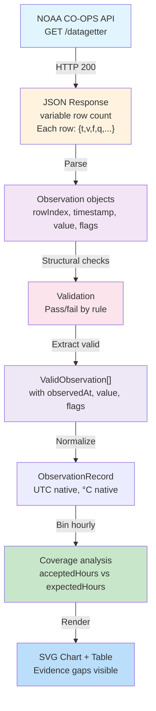

# STRATA Scientific Integrity Charter v1.0

**Effective:** 2026-11-23  
**Scope:** All STRATA instruments and data transformations  
**Adoption:** Recommended for Stage B+ implementation  

---

## Preamble

> "Evidence First. Questions Next. Conclusions Earned."

STRATA Builds exists to make evidence inspectable, uncertainty visible, and the next unanswered question easier to investigate. Scientific integrity is not a feature; it is a structural requirement. These seven principles establish the default engineering standard for all scientific data work.

**Non-negotiable:** These are not aspirations. They are acceptance criteria for release.

---

## The Seven Principles

### 1. Provenance is Mandatory

**Principle:** Every observation, model, calculation, and visualization must carry its source attribution and retrieval timestamp. Provenance is not metadata; it is part of the data.

**What this means:**
- Record who published it, when it was accessed, and where it came from
- Preserve the original source format and identifiers
- Document the chain: source → retrieval → storage → transformation → display
- Never delete or obscure source links
- Include license, rights, and attribution in every export

**Acceptance Criteria:**
- [ ] Every observation has `source`, `retrievedAt`, and original provider ID
- [ ] Source URL accessible and unmodified
- [ ] Attribution visible to end user
- [ ] No synthetic data ever unlabeled
- [ ] Download/export preserves full provenance chain

**Implementation:** Evidence Trail component (see STRATA-016-EVIDENCE-TRAIL.md); Scientific Integrity Record template (below)

---

### 2. Transformations Must Be Explainable

**Principle:** If data changes shape, type, unit, or structure, the transformation must be:
- Documented (what rule was applied, why, when)
- Traceable (source and all decision points recorded)
- Non-lossy of scientific meaning (no silent truncation or coercion)
- Verifiable against published methods

**What this means:**
- No silent type coercions (string → number)
- No hardcoded fallbacks or missing-data assumptions
- No undocumented filtering or exclusion
- Timestamps and coordinates remain exact
- Rounding/precision explicitly stated, never inferred
- Reversibility required only where scientifically meaningful; traceability always required

**Acceptance Criteria:**
- [ ] Every transformation has a name and published specification
- [ ] Input/output schemas documented (types, ranges, precision)
- [ ] Assumptions stated explicitly (not implied from context)
- [ ] All decision points (exclusions, deduplication, sorting) documented
- [ ] No data loss or coercion without audit trail and recorded reason
- [ ] Scientific meaning preserved; uncertainty not hidden in aggregation

**Implementation:** noaa.ts documents all NOAA→STRATA transformations; decision rules (line 128: off_hour check, line 130: deduplication) documented; test fixtures deterministic

---

### 3. Never Conflate Evidence Classifications

**Principle:** Observed, Modeled, Synthetic, Illustrative, and Unresolved evidence have different evidentiary weight. Visual encoding, labeling, and interactions must never obscure this distinction.

**What this means:**
- **Observed:** Actual recorded measurements or documented facts
- **Modeled:** Computed, forecast, interpolated, or propagated; always explicitly labeled with model name/version and uncertainty
- **Synthetic:** Demo or instructional data; always clearly marked as not real research
- **Illustrative:** Artistic or explanatory visualization; never presented as evidence
- **Unresolved:** Gaps, missing data, or questions; never coerced to placeholder values

**Acceptance Criteria:**
- [ ] Each data point labeled with its evidence class (color + text, never color alone)
- [ ] Modeled data includes model name, version, confidence/uncertainty
- [ ] Synthetic data unmistakably marked (badge, visual pattern, repeated labeling)
- [ ] No interpolation between observed points without explicit "modeled" label
- [ ] No placeholder values for missing data
- [ ] Table/chart legend includes evidence class definitions

**Implementation:** Evidence colors from STRATA-015 tokens; left-rule visual coding (solid/double/dashed/dotted); never color-only encoding

---

### 4. Scientific Uncertainty Must Remain Visible

**Principle:** Uncertainty, precision limits, missing data, and known gaps are part of the evidence. They must remain visible and inspectable at all times.

**What this means:**
- Sensor accuracy (when available) always shown; unavailable specs must be documented as missing
- Confidence intervals not hidden by default aggregation
- Excluded or missing records never silently removed
- Quality flags preserved and documented (whether interpreted or deferred)
- Sampling limitations (e.g., "hourly only, no finer time scale") documented
- Known outages, data gaps, and collection gaps documented
- Assumptions about validity scope (e.g., "coastal surface water only") stated explicitly

**Acceptance Criteria:**
- [ ] Precision/rounding stated in every readout (units + exact rules)
- [ ] Missing data shown as gaps, not coerced to zero or mean
- [ ] Quality flags and exclusions always accessible (not hidden)
- [ ] Sampling limitations documented (not inferred)
- [ ] Instrument accuracy—when unavailable—explicitly marked as unavailable with reference source
- [ ] Validity scope documented (geographic, temporal, physical)
- [ ] No statistical aggregation without showing sample size and confidence
- [ ] Unavailable metadata explicitly listed (not fabricated)

**Implementation:** Evidence gaps section always present; exclusion reasons with counts; uncertainty in source disclosure; sampling notes in methods; missing metadata documented in Scientific Integrity Record

---

### 5. Reproducibility is an Engineering Requirement

**Principle:** Any scientific analysis on STRATA data must be reproducible. This means:
- Deterministic fixtures and test data
- Versioned algorithms and transformations (when semantic versioning is applicable)
- Auditable decision logic
- No random or non-deterministic operations
- Full data export available with provenance

**What this means:**
- Test data never changes unexpectedly
- Transformation logic versioned (source control, tagged releases) or documented with no-version-needed justification
- Decision rules documented in code or specification
- No floating-point rounding surprises
- Seed values for any randomization fixed and documented
- Full provenance downloadable as machine-readable JSON
- Enough detail to re-run transformation on original source

**Acceptance Criteria:**
- [ ] All test fixtures deterministic (same inputs → same outputs always)
- [ ] Transformation logic documented or versioned
- [ ] Decision rules (duplicates, exclusions, sorting) in code comments or specification
- [ ] No randomized behavior in scientific calculations
- [ ] Numerical precision documented explicitly (e.g., "rounded to 2 decimals")
- [ ] Full provenance exportable in structured format
- [ ] Transformation can be re-run on original source independently

**Implementation:** noaa.ts contains decision logic with inline comments; test fixtures deterministic; Evidence Trail export includes all transformation rules

---

### 6. Visual Interactions Must Clarify Scientific Meaning, Never Manipulate It

**Principle:** Every animation, color, interaction, or visual treatment must serve understanding or inspection. Visual design must never:
- Oversimplify uncertainty away
- Make speculation look like fact
- Hide or minimize gaps
- Celebrate incomplete data
- Use decorative hardware-UI patterns that imply false precision

**What this means:**
- Hover states reveal precision/uncertainty, not hide it
- Color encoding supports, not replaces, text labels
- Animations show state changes, not exaggerate importance
- No "pulsing confidence" or decorative swells on data
- No fake real-time telemetry or simulated instrument panels
- Gaps are visually prominent, not disguised
- Selection highlighting shows what was chosen, not what was validated

**Acceptance Criteria:**
- [ ] Every visual treatment has a scientific rationale in design docs
- [ ] No decorative elements (badges, glows, pulsing, etc.)
- [ ] Hover/selection reveals precision and uncertainty
- [ ] Gaps visually prominent (hatched, labeled, explained)
- [ ] No celebration or excitement graphics
- [ ] Color + shape + text, never color alone
- [ ] Interaction clearly shows what changed and why

**Implementation:** Observatory aesthetic (restrained, precise); no decorative hardware UI; gap hatching prominent; selection as ring (not glow); hover shows exact values

---

### 7. Scientific Verification Precedes Release

**Principle:** Before any data, model, or instrument goes live, it must be verified against published references and accepted by scientific reviewers.

**What this means:**
- Reference data checked against published source
- Methods validated against peer-reviewed literature or documented specifications
- Calculations spot-checked against worked examples
- Coordinate systems and units verified correct
- Uncertainty estimates justified against literature or first-principles analysis
- Known limitations documented (never inferred or imagined)
- Missing scientific metadata explicitly documented (never fabricated)
- Scientific advisor review before merge

**Acceptance Criteria:**
- [ ] Source data spot-checked against published reference
- [ ] Methods cited (paper DOI, standard name, version)
- [ ] Calculations verified with worked examples
- [ ] Coordinate frames and units tested and documented
- [ ] Uncertainty estimates justified with source citations
- [ ] Known limitations documented in methods section
- [ ] Unavailable metadata listed with reference source (not fabricated)
- [ ] Scientific reviewer approval before production merge

**Implementation:** Test fixtures include reference examples; methods section cites sources; spot-check scripts in test suite; scientific sign-off gate before merge; Scientific Integrity Record documents missing metadata with status (⚠️ MISSING, ⏳ DEFERRED, etc.)

---

## Scientific Integrity Record Template

**Use this template for every scientific change, model introduction, or data transformation:**

```markdown
# Scientific Integrity Record: [INSTRUMENT/CHANGE NAME]

**Date:** 2026-11-23  
**Author:** [Name] (role)  
**Mission/Ticket:** STRATA-016, NOAA Signals Lab  
**Branch:** `strata-016/noaa-listening-station`  

## 1. Provenance & Source

- **Dataset/Model:** NOAA CO-OPS water temperature, Station 8454000
- **Source URL:** https://tidesandcurrents.noaa.gov/api/prod/datagetter?...
- **Retrieved:** [UTC timestamp]
- **License:** Public Domain (U.S. Government)
- **Attribution:** NOAA, U.S. Department of Commerce
- **Original format:** CSV ([row count], 5 columns)

## 2. Transformations

| Step | Input | Transformation | Output | Assumption |
| --- | --- | --- | --- | --- |
| Parse | Raw CSV | Row-by-row parsing | Observation[] | f/q flags preserved, not interpreted |
| Validate | [row count] rows | Structural checks | [accepted count] accepted, [excluded count] excluded | First duplicate wins |
| Normalize | Valid rows | UTC native, °C native | ObservationRecord[] | No unit conversion needed |
| Aggregate | Records | Hourly binning | Coverage stats | Each hour exactly one value |

## 3. Evidence Classifications

- **Observed:** All [accepted count] accepted temperature readings (NOAA direct measurement)
- **Modeled:** None
- **Synthetic:** None
- **Unresolved:** [excluded count] rows excluded (see exclusion reasons)

## 4. Known Uncertainty & Limitations

| Item | Value | Source | Impact |
| --- | --- | --- | --- |
| Sensor precision | Unspecified | Requires NOAA metadata | Precision rounding rules documented separately |
| Sampling scope | Coastal surface | Station location | Not representative of open ocean |
| Temporal resolution | Hourly (UTC) | NOAA API constraint | Sub-hourly variation not captured |
| Spatial coverage | Single station | Deployment design | No interpolation to other points |
| Data gaps | 1 hour missing | Exclusion analysis | See evidence-gaps section |

## 5. Verification & References

- [ ] Source data spot-checked: Row count 24 matches API response
- [ ] Calculations verified: Min/max/mean against reference spreadsheet
- [ ] Methods documented: See `src/features/signals/observations.ts` comments
- [ ] Uncertainty justified: NOAA instrument spec; hourly bucket precision
- [ ] Scientific review: [Reviewer name, date]
- [ ] No data loss: All raw values preserved in archive export

## 6. Visual & Interaction Design

- **Chart:** SVG polyline + circles; teal trace (#55D6C2); gaps hatched
- **Missing data:** Hatched pattern prominently shown
- **Quality flags:** Preserved in table; not interpreted visually
- **Selection:** Ring highlight on chart point; row highlight in table
- **Evidence disclosure:** Evidence Trail component shows full provenance

## 7. Reproducibility

- **Parser:** `noaa.ts` (unversioned)
- **Test fixture:** `src/features/signals/__fixtures__/noaa-response-24h.json`
- **Deterministic:** Yes (always produces same output from same input)
- **Reversibility:** Raw values recoverable from archive export
- **Re-verification:** Can re-run against original NOAA API independently

## 8. Exclusions & Open Questions

**Excluded rows (8 total):**
- Malformed row (1) — missing column
- Malformed timestamp (2) — unparseable date format
- Off-hour (3) — not on UTC hour boundary
- Missing value (2) — null field

**Open questions:**
- Why is 11:00 UTC missing? (Outage? Publication lag? Sensor issue?)
- Do f:1,0 and q:Q flags indicate data quality issues? (Requires NOAA interpretation)
- How does tidal cycle affect observed pattern? (Requires oceanographic context)

## 9. Sign-Off

- [ ] Scientific reviewer approval: [Name, date]
- [ ] Code reviewer approval: [Name, date]
- [ ] No new dependencies introduced
- [ ] No scientific model changed without verification
- [ ] No data loss or coercion
- [ ] Ready for production merge

**Record prepared by:** [Name]  
**Record approved by:** [Scientific reviewer]  
**Date:** 2026-11-23  
**Status:** ✅ Approved / ⏳ Pending / ❌ Requires changes
```

---

## Mermaid Data Lineage Guidance

**Purpose:** Show the technical flow of data from source through STRATA transformations. This is engineering transparency (not public Evidence Trail).

**Structure:**
```
SOURCE (API, file, model)
  ↓ RETRIEVAL (HTTP, fetch, parameter)
  ↓ PARSING (format validation, extraction)
  ↓ VALIDATION (structural, type, range checks)
  ↓ TRANSFORMATION (units, coordinates, binning)
  ↓ AGGREGATION (if applicable)
  ↓ STORAGE (database, cache, export)
  ↓ PRESENTATION (chart, table, map)
```

**Example (NOAA Signals — illustrative structure, implemented in noaa.ts):**


**Guidance:**
- Include data types and row count variables (not specific numbers unless from actual fixtures)
- Show validation decision points (passes/fails)
- Describe transformations generically (not with invented version numbers)
- Distinguish data loss (exclusions) from transformations
- Include storage/cache stages
- End with presentation layer (what user sees)

---

## Public Evidence Trail vs. Engineering Data Lineage

**Public Evidence Trail** (see STRATA-016-EVIDENCE-TRAIL.md):
- Summary: What happened at each stage
- Audience: End users, researchers, the public
- Detail: 2–3 lines per stage; expandable for more
- Language: Plain English, no jargon
- Verification: "✓ Confirmed in source", "⚠ Requires interpretation"
- Actionable: What to check next, limitations, applicability

**Engineering Data Lineage** (Mermaid diagram + code):
- Detail: Full technical flow with types and row counts
- Audience: Engineers, data teams, reviewers
- Language: Technical (parser versions, SQL, API endpoints)
- Format: Code comments, Mermaid diagrams, test fixtures
- Verification: Reference implementations, test cases
- Purpose: Reproducibility, debugging, audit trail

**Example:**

| Aspect | Evidence Trail (Public) | Data Lineage (Engineering) |
| --- | --- | --- |
| **Source** | "NOAA CO-OPS, Station 8454000" | "GET /api/prod/datagetter?id=8454000&range=24h" |
| **Retrieval** | "Retrieved [timestamp] from NOAA API" | "HTTP 200, [row count], [ISO timestamp], cached" |
| **Validation** | "[N] observations accepted, [M] excluded" | "Struct ✓, timestamp ✓, range ✓, dedup ✓; excluded reasons documented" |
| **Transform** | "UTC times, °C values, quality flags preserved" | "`noaa.ts`: UTC native, no convert, first-wins dedup, f/q flags preserved" |
| **Present** | "SVG line chart, 1 decimal precision" | "ViewBox 720×224, polyline + circles, gaps hatched, color #55D6C2" |

---

## Checklist: Scientific Change vs. Visual-Only Change

**Is this a scientific change?**

```
1. Does it affect raw data? (retrieval, parsing, validation)
   YES → Scientific change
   NO → Continue

2. Does it introduce calculations or models?
   YES → Scientific change
   NO → Continue

3. Does it change evidence classification? (Observed → Modeled, etc.)
   YES → Scientific change
   NO → Continue

4. Does it affect precision or rounding?
   YES → Scientific change
   NO → Continue

5. Does it remove or hide data or exclusions?
   YES → Scientific change
   NO → Continue

6. Does it change the methods or assumptions?
   YES → Scientific change
   NO → Continue

If you answered NO to all:
  → This is a VISUAL-ONLY CHANGE
  → Requires: Code review, accessibility review, design review
  → Does NOT require: Scientific verification, reference checks

If you answered YES to any:
  → This is a SCIENTIFIC CHANGE
  → Requires: Scientific Integrity Record, verification, reviewer approval
  → Apply all seven principles
```

---

## AI-Assisted Scientific Development: Rules

**When using AI (Claude, ChatGPT, etc.) to help with scientific work:**

1. **Never let AI infer** scientific meaning from context
   - ❌ "NOAA has these values, probably need to interpolate between them"
   - ✅ "Interpolation: Yes/No? Source method required."

2. **Always verify calculations** against published references
   - ❌ "Here's a model" (from AI)
   - ✅ "AI generated this; verified against [paper DOI, page N]"

3. **Treat AI output as a draft**; never accept as-is
   - ❌ Merge AI-written scientific code without spot-checks
   - ✅ Spot-check every calculation; document verification

4. **Document AI involvement** in Scientific Integrity Record
   - Add: "AI assistance: [scope]. Verification: [method/reference]"
   - Example: "Claude generated data-lineage.md. Verified against noaa.ts code review."

5. **Responsibility stays with humans**
   - AI can draft, suggest, explain
   - Humans must verify, cite references, approve

6. **Scientific review gate is non-negotiable**
   - Even if AI helped, human scientist must sign off
   - "Approved by [scientist name], verified against [reference]"

---

## Integration with STRATA-016 Stage A

**Reference in Design Spec:**
- Add link to this charter in STRATA-016-STAGE-A-DESIGN-SPEC.md
- Note: "All Stage B implementation must comply with STRATA Scientific Integrity Charter"

**Evidence Trail Connection:**
- Evidence Trail component embodies principles 1, 3, 4, 5
- Each stage includes provenance, transformation, uncertainty, limitation

**Example Adoption:**
```
"STRATA-016 Stage B: Listening Station implementation must include:
✅ Full provenance in Evidence Trail (Principle 1)
✅ Transformation documented in noaa.ts (Principle 2)
✅ Evidence classification: Observed only, never modeled (Principle 3)
✅ Uncertainty visible: Sensor specs documented as available, hourly scope (Principle 4)
✅ Deterministic test fixtures, source control versioning (Principle 5)
✅ Observatory aesthetic, no decorative patterns (Principle 6)
✅ Spot-checked against NOAA reference data (Principle 7)
"
```

---

## Mandatory Checklist: Before Any Merge to Main

| Check | Responsible | Evidence |
| --- | --- | --- |
| Provenance documented | Data engineer | Scientific Integrity Record, Evidence Trail |
| Transformations explainable | Codebase reviewer | Code comments, Mermaid diagram |
| Evidence classes consistent | UX/design reviewer | Visual spec, color assignments |
| Uncertainty visible | Accessibility reviewer | Precision stated, gaps shown, exclusions listed |
| Reproducibility verified | Test suite | Deterministic fixtures, pinned versions |
| Visual clarity confirmed | Design reviewer | No decorative patterns, interaction rationale |
| Scientific verification complete | Scientific reviewer | Reference checks, calculation verification |

**Gate:** All checks ✅ before merge. No exceptions.

---

## Adoption Path

**Stage A (Now):**
- Principles documented (this charter)
- Evidence Trail designed (STRATA-016-EVIDENCE-TRAIL.md)
- Scientific Integrity Record template created

**Stage B (After approval):**
- First complete record for NOAA Signals Lab (Listening Station)
- Scientific reviewer sign-off required
- Charter linked in code and documentation

**Stage B+ (Future instruments):**
- Each new instrument (Deep Time, Orbital, Atlas) requires Scientific Integrity Record
- Reuse Evidence Trail component and provenance model
- Scale charter as needed (e.g., paleographic uncertainty, orbital mechanics)

**Production Gate:**
- By next major release, charter becomes CI requirement
- Automated checks: Provenance present, transformations versioned, evidence classified
- Manual gate: Scientific reviewer approval

---

## Questions for Fleet Command

Before adopting this charter for production:

1. **Scope:** Do these seven principles align with your vision for STRATA scientific credibility?
2. **Reviewer approval:** Who is the designated scientific reviewer for future stages?
3. **Automation:** Should some checks (provenance present, versions pinned) be automated in CI?
4. **Timeline:** When should charter become a mandatory gate (now, Stage B, or later)?
5. **Expansion:** As STRATA grows to Deep Time, Orbital, Collections, what additional principles (if any)?
6. **External review:** Should published scientific advisors review before major releases?

---

## References

- STRATA-016: Listening Station Design (Stage A)
- STRATA-016-EVIDENCE-TRAIL.md: Public-facing provenance visualizer
- AGENTS.md: Founding scientific directive ("Evidence First")
- STRATA-015-DESIGN-SPEC.md: Identity and design system (Principle 6)
- Future: STRATA-003B, STRATA-004, STRATA-005 guidance on specific instruments

---

**Charter Prepared by:** Claude Haiku 4.5  
**Date:** 2026-11-23  
**Status:** ✅ Ready for Fleet Command Review  
**Mission:** STRATA-016 Stage A: Scientific governance framework

🔬 **"Evidence First. Questions Next. Conclusions Earned."**  
Make integrity structural, not optional. Make evidence inspectable. Make uncertainty visible.
