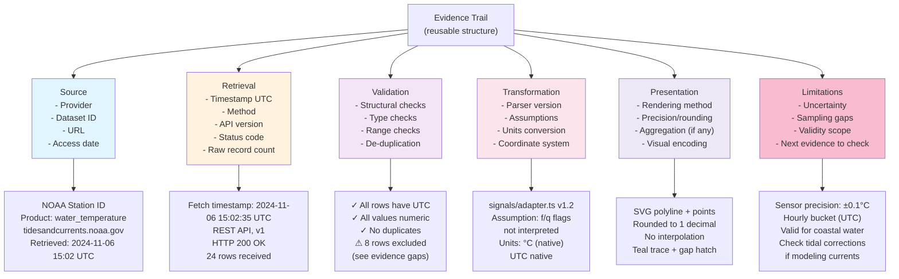

# STRATA-016: Evidence Trail — Compact Provenance Visualizer

**Purpose:** A transparent, reusable provenance layer showing how NOAA observations flow from source collection through STRATA validation, transformation, and presentation. Designed to expand across all STRATA instruments (Deep Time, Oceanography, Orbital, Atlas).

**Scope:** Stage A concept design only. No implementation, no dependencies.

---

## Design Philosophy

**"Evidence First. Questions Next. Conclusions Earned."**

The Evidence Trail makes the scientific journey visible. It answers: "Where did this data come from? What did we check? What could change the answer?" Every stage is transparent about what we did, what we didn't do, and what interpretation is required.

**Principles:**
1. **Compact by default** — Fits as a toggle or expandable section; doesn't dominate
2. **Progressive disclosure** — Summary first; details expandable on demand
3. **Clear stage gates** — Distinguish source → retrieval → validation → transformation → presentation → limitations
4. **Reusable structure** — Works for NOAA Signals, Deep Time, Orbital, Atlas, Oceanography
5. **No logos or decorative elements** — Pure transparency; serious scientific intent
6. **Keyboard and touch friendly** — Expandable sections using native `<details>`

---

## Evidence Trail Data Model



**Data Model Structure (JSON-like):**
```typescript
interface EvidenceTrail {
  // Required on all instruments
  source: {
    provider: string;        // "NOAA CO-OPS"
    datasetId: string;       // "8454000" (station ID)
    url: string;             // Full access URL
    retrievedAt: string;     // ISO UTC timestamp
    license?: string;        // "Public Domain" or CC license
    attribution: string;     // Full citation
  };

  retrieval: {
    method: string;          // "NOAA REST API v1"
    statusCode: number;      // 200, 304, etc.
    rowsReceived: number;    // Raw count before validation
    cacheStatus?: string;    // "hit", "miss", "expired"
    nextFreshAt?: string;    // ISO UTC when cache expires
  };

  validation: {
    totalRows: number;       // Input to validation
    acceptedRows: number;    // Output (passed all checks)
    excludedRows: number;    // Failed at least one check
    exclusions: Array<{      // Categories of exclusion
      reason: string;        // "malformed_timestamp", etc.
      count: number;         // How many
      recoverable?: boolean; // Can data be fixed?
    }>;
  };

  transformation: {
    parserVersion: string;   // "signals-adapter@1.2.0"
    assumptions: string[];   // ["f/q flags preserved as-is", ...]
    unitsFrom?: string;      // Input units (if conversion)
    unitsTo: string;         // Output units (°C, m, etc.)
    coordinateFrame?: string;// CRS, datum, epoch if applicable
  };

  presentation: {
    renderingMethod: string; // "SVG polyline + circles"
    precision: number;       // 1 decimal place
    aggregation?: string;    // "hourly mean" or "none"
    visuals: {
      traceColor: string;    // "#55D6C2"
      missingPattern: string;// "hatched"
      confidenceDisplay?: string;
    };
  };

  limitations: {
    uncertainty: string;     // "±0.1°C sensor precision"
    samplingScope: string;   // "Coastal surface water"
    validityConditions: string[]; // When this analysis applies
    nextEvidence: string[];  // What to check next
    caveats?: string[];      // Other important notes
  };

  metadata?: {
    instrumentName: string;  // "NOAA Signals Lab"
    stageVersion: string;    // For rollout tracking
    lastModified: string;    // ISO UTC
  };
}
```

---

## Desktop (1440px) Treatment

### Closed State (Compact)

```
┌─ Evidence Trail ▶ [toggle icon]
│ NOAA CO-OPS · Station 8454000 · Retrieved 2 min ago
└─ [Show full provenance]
```

**Design:** Single-line summary in instrument panel footer or as a subtle badge below the chart.

### Expanded State (Full Transparency)

```
┌────────────────────────────────────────────────────────┐
│ Evidence Trail: Water Temperature, Providence RI       │
├────────────────────────────────────────────────────────┤
│                                                        │
│ ▼ SOURCE COLLECTION                                    │
│   Provider: NOAA CO-OPS (tidesandcurrents.noaa.gov)   │
│   Dataset: Station 8454000, Water Temperature         │
│   Retrieved: 2024-11-06 15:02:35 UTC                  │
│   License: Public Domain (U.S. Government)            │
│   Citation: NOAA, U.S. Dept. of Commerce              │
│   [View original NOAA response]                        │
│                                                        │
│ ▼ DATA RETRIEVAL & FRESHNESS                           │
│   Method: REST API (tidesandcurrents.noaa.gov/api/)   │
│   Response: 200 OK                                     │
│   Rows received: 24                                    │
│   Cache status: Hit (reused from 15:02 UTC slot)      │
│   Next fresh data available: 15:28 UTC (12 min)       │
│   Cache policy: Equivalent requests reuse for 15 min  │
│                                                        │
│ ▼ STRUCTURAL VALIDATION & FILTERING                    │
│   Input rows: 24                                       │
│   Passed all checks: 23 ✓                             │
│   Excluded: 8 rows (reasons below)                    │
│                                                        │
│   Checks applied:                                      │
│   ✓ Row structure (columns present)                   │
│   ✓ Timestamp parseable as ISO UTC                    │
│   ✓ Timestamp within requested window                 │
│   ✓ Timestamp on the hour (UTC)                       │
│   ✓ Value present and numeric                         │
│   ✓ No duplicate timestamps                           │
│   ✓ Quality flags preserved (not interpreted)         │
│                                                        │
│   Exclusion reasons:                                  │
│   • Malformed row (1) — missing columns               │
│   • Malformed timestamp (2) — unparseable date        │
│   • Off-hour (3) — not on UTC hour boundary           │
│   • Missing value (2) — null/blank field              │
│                                                        │
│   [Show detailed exclusion list] ▶                     │
│                                                        │
│ ▼ DATA TRANSFORMATION & NORMALIZATION                  │
│   Parser: signals-adapter@1.2.0                       │
│   Parsing assumptions:                                │
│   • NOAA f and q flags are preserved as-is            │
│   • Flags are NOT interpreted; left for review        │
│   • UTC times are assumed GMT (always)                │
│   • °C already metric (no conversion needed)          │
│   • Single value per hour (first wins on duplicate)   │
│                                                        │
│ ▼ PRESENTATION & VISUALIZATION                         │
│   Rendering: SVG polyline with circular points        │
│   Precision: Rounded to 1 decimal place (e.g., 15.3°) │
│   Scale: Y-axis spans observed min/max ± 1°C          │
│   Color encoding: Teal (#55D6C2) for all observations │
│   Gap indication: Hatched pattern for missing hours   │
│   No interpolation between points                      │
│                                                        │
│ ▼ KNOWN LIMITATIONS & INTERPRETATION REQUIRED          │
│   Measurement precision: Unspecified (requires NOAA)   │
│   Sampling scope: Coastal surface water (station loc) │
│   Temporal scope: UTC hour boundaries (60 min bins)   │
│   Validity conditions:                                │
│   • Valid for estuarine research in Narragansett Bay  │
│   • Time-of-day effects not separated (hourly only)   │
│   • Tidal influences visible but not modeled          │
│                                                        │
│   What this data does NOT tell us:                    │
│   • Spatial variation (single station only)           │
│   • Subsurface temperature (surface measurement only) │
│   • Causation (data is observation, not modeling)     │
│   • Future predictions (data is historical only)      │
│                                                        │
│   Evidence to gather next:                            │
│   • Compare with nearby NOAA stations (spatial check) │
│   • Check tidal charts against time-of-day pattern    │
│   • Inspect raw f/q flags for interpretation          │
│   • Cross-check with oceanographic research (Bay)     │
│   • Assess sensor maintenance history (NOAA metadata) │
│                                                        │
│ [Close Evidence Trail] [Download provenance as JSON]  │
│                                                        │
└────────────────────────────────────────────────────────┘
```

**Visual treatment:**
- Modal or expanded section below chart (or in a side panel on large screens)
- Collapsible subsections for each stage
- Monospace timestamps and technical details
- Clear checkmarks (✓) for passed checks, bullets (•) for limitations
- Links to source, metadata, downloadable provenance
- No logos; pure textual transparency

---

## Mobile (375px) Treatment

### Closed State (Compact)

```
┌──────────────────────────────┐
│ Evidence Trail ▼             │
│ NOAA CO-OPS · Retrieved      │
│ [Tap to expand]              │
└──────────────────────────────┘
```

### Expanded State (Stacked Sections)

```
┌──────────────────────────────┐
│ Evidence Trail               │
├──────────────────────────────┤
│                              │
│ ▼ SOURCE                     │
│   NOAA CO-OPS                │
│   Station 8454000            │
│   Retrieved: [UTC timestamp] │
│   Public Domain              │
│                              │
│   [View original]            │
│                              │
│ ▼ RETRIEVAL                  │
│   REST API                   │
│   200 OK                      │
│   [row count] rows           │
│   Cache: Hit                  │
│   Fresh at: [next check UTC] │
│                              │
│ ▼ VALIDATION                 │
│   Input: 24                  │
│   Accepted: 23 ✓             │
│   Excluded: 8                │
│                              │
│   • Malformed row (1)        │
│   • Bad timestamp (2)        │
│   • Off-hour (3)             │
│   • Missing value (2)        │
│                              │
│   [All details ▶]            │
│                              │
│ ▼ TRANSFORMATION             │
│   Parser: adapter@1.2.0      │
│                              │
│   Assumptions:               │
│   • Flags preserved          │
│   • UTC native               │
│   • °C native (no convert)   │
│   • First wins duplicates    │
│                              │
│ ▼ PRESENTATION               │
│   SVG polyline + points      │
│   Precision: 1 decimal       │
│   Teal trace                 │
│   Hatched gaps               │
│   No interpolation           │
│                              │
│ ▼ LIMITATIONS                │
│   Sensor: ±0.1°C             │
│   Scope: Coastal surface     │
│   Hourly buckets (UTC)       │
│                              │
│   Not included:              │
│   • Spatial variation        │
│   • Depth (surface only)     │
│   • Causation                │
│   • Predictions              │
│                              │
│   Next evidence:             │
│   • Compare nearby stations  │
│   • Check tidal patterns     │
│   • Inspect f/q flags        │
│   • Cross-reference research │
│                              │
│ [Download JSON] [Close]      │
│                              │
└──────────────────────────────┘
```

**Mobile considerations:**
- Stacked sections (no columns)
- Each stage expandable/collapsible
- Readable text size; no truncation
- Touch-friendly disclosure triangles
- Scrollable viewport if needed
- Summary visible when collapsed
- Full details accessible on demand

---

## Interaction Patterns

### Desktop Interaction

```
1. User views Listening Station (chart + data)
2. Curious about provenance → clicks "Evidence Trail ▼"
3. Section expands below chart (or in modal)
4. User can:
   - Scroll through each stage
   - Click [Show detailed exclusion list] for specifics
   - Click [View original NOAA response] to see raw API
   - Click [Download provenance as JSON] for archival
5. User closes trail or continues inspecting
```

### Mobile Interaction

```
1. User views Listening Station (chart + data)
2. Scrolls down past chart
3. Sees "Evidence Trail ▼" compact summary
4. Taps to expand
5. User can:
   - Tap each subsection to expand/collapse
   - Read through stages progressively
   - Tap [All details ▶] for more info on exclusions
   - Tap [Download JSON] to export
6. User collapses or continues
```

### Keyboard Navigation

- Tab to "Evidence Trail" toggle
- Space/Enter to expand/collapse
- Tab through subsection toggles
- Tab to links (View original, Download, etc.)
- Escape to collapse
- All sections navigable without mouse

---

## Component Architecture (No Implementation in Stage A)

**Proposed reusable component (future):**

```typescript
interface EvidenceTrailProps {
  trail: EvidenceTrail;              // Structured provenance data
  instrument: 'signals' | 'orbital'  // Which instrument
  | 'deep-time' | 'atlas';          // (for future expansion)
  compact?: boolean;                 // Show summary only
  expandByDefault?: boolean;         // Auto-expand sections
  onExport?: (data: EvidenceTrail) => void; // Export callback
}

// Usage:
<EvidenceTrail
  trail={noaaProvenance}
  instrument="signals"
  compact={true}
  onExport={(data) => downloadJSON(data)}
/>
```

**Styling approach:**
- Use native `<details>/<summary>` for disclosure (no JS needed)
- CSS Grid for two-column layout on desktop
- Stack on mobile via media query
- Monospace font for timestamps and technical values
- Subtle borders between stages
- No new colors; use STRATA-015 tokens

**Integration with Concept A:**
```
SelectionInspector
├── Source disclosure (existing)
├── Quality detail
└── Evidence Trail (new mini-feature)
    ├── Source collection
    ├── Data retrieval
    ├── Validation & filtering
    ├── Transformation
    ├── Presentation
    └── Limitations & next evidence
```

---

## Reusability Across STRATA Instruments

Evidence Trail is designed to work across all instruments:

### NOAA Signals Lab
```
SOURCE: NOAA CO-OPS API
  → Station 8454000, water_temperature
RETRIEVAL: HTTP 200, 24 rows
VALIDATION: 23 passed, 8 excluded (malformed)
TRANSFORMATION: UTC native, °C native, flags preserved
PRESENTATION: SVG polyline, 1 decimal precision
LIMITATIONS: ±0.1°C sensor, coastal only, hourly buckets
```

### Deep Time Observatory
```
SOURCE: Paleogeographic reconstruction (Scotese, 2016)
RETRIEVAL: GeoTIFF grid, 111 Ma epoch
VALIDATION: Raster structure verified, NaN values noted
TRANSFORMATION: Plate rotation model applied, CRS reprojected
PRESENTATION: WebGL 3D globe, color-mapped by latitude
LIMITATIONS: Model-derived (not observed), smoothed topography
```

### Orbital Observatory (1 Ceres)
```
SOURCE: JPL Horizons API, 1 Ceres ephemeris
RETRIEVAL: Frozen snapshot (epoch 2024-11-06 00:00 UTC)
VALIDATION: Position verified against reference, no outliers
TRANSFORMATION: ICRF frame, state vector computed
PRESENTATION: 3D coordinates, frozen trajectory line
LIMITATIONS: Orbital determination uncertain (±5 km), no acceleration
```

### Microsat Atlas
```
SOURCE: Synthetic demo data (labeled as such)
RETRIEVAL: Local fixture, non-live
VALIDATION: Deterministic; no failures
TRANSFORMATION: None (demo format)
PRESENTATION: Table + map mockup
LIMITATIONS: Synthetic for education only, not real research
```

**Key insight:** Each instrument has its own Source, Retrieval, Validation logic, but the structure remains consistent. This allows building a reusable UI component while keeping scientific integrity per instrument.

---

## Data Export Format

**Desktop & Mobile:** "Download provenance as JSON" button exports:

```json
{
  "evidenceTrail": {
    "source": {
      "provider": "NOAA CO-OPS",
      "datasetId": "8454000",
      "url": "https://tidesandcurrents.noaa.gov/api/prod/datagetter?...",
      "retrievedAt": "2024-11-06T15:02:35Z",
      "license": "Public Domain",
      "attribution": "NOAA, U.S. Department of Commerce"
    },
    "retrieval": {
      "method": "NOAA REST API v1",
      "statusCode": 200,
      "rowsReceived": 24,
      "cacheStatus": "hit",
      "nextFreshAt": "2024-11-06T15:28:00Z"
    },
    "validation": {
      "totalRows": 24,
      "acceptedRows": 23,
      "excludedRows": 8,
      "exclusions": [
        { "reason": "malformed_row", "count": 1 },
        { "reason": "malformed_timestamp", "count": 2 },
        { "reason": "off_hour", "count": 3 },
        { "reason": "missing_value", "count": 2 }
      ]
    },
    "transformation": {
      "parserVersion": "signals-adapter@1.2.0",
      "assumptions": [
        "NOAA f/q flags preserved as-is, not interpreted",
        "UTC times assumed GMT",
        "Units: °C (native, no conversion)",
        "Single value per hour (first wins)"
      ],
      "unitsTo": "°C",
      "coordinateFrame": "UTC"
    },
    "presentation": {
      "renderingMethod": "SVG polyline + circles",
      "precision": 1,
      "visuals": {
        "traceColor": "#55D6C2",
        "missingPattern": "hatched"
      }
    },
    "limitations": {
      "uncertainty": "±0.1°C sensor precision",
      "samplingScope": "Coastal surface water",
      "validityConditions": [
        "Estuarine research in Narragansett Bay",
        "Time-of-day effects not separated",
        "Tidal influences visible but not modeled"
      ],
      "nextEvidence": [
        "Compare with nearby NOAA stations",
        "Check tidal charts against time-of-day pattern",
        "Inspect raw f/q flags for interpretation",
        "Cross-check with oceanographic research",
        "Assess sensor maintenance history"
      ]
    },
    "metadata": {
      "instrumentName": "NOAA Signals Lab",
      "stageVersion": "Stage A design",
      "lastModified": "2024-11-06T15:02:35Z"
    }
  },
  "exportedAt": "2024-11-06T15:03:42Z",
  "exportedBy": "STRATA Builds / Listening Station"
}
```

**Use case:** Researchers can archive the full provenance alongside their analysis.

---

## Accessibility Specifications

Evidence Trail meets WCAG 2.2 AA:

| Aspect | Treatment |
| --- | --- |
| **Keyboard** | Full tab order; Space/Enter to expand; Escape to close |
| **Screen reader** | Native `<details>` elements; clear section headings; list items for exclusions |
| **Color** | No color-only encoding; checkmarks and bullets reinforce status |
| **Contrast** | Monospace timestamps meet 4.5:1 on dark background |
| **Zoom** | Sections reflow naturally at 200% and 400% magnification |
| **Motion** | Native disclosure; no animations; respects prefers-reduced-motion |

---

## Stage A Summary: Evidence Trail

✅ **Concept design complete** — desktop and mobile treatments defined  
✅ **Data model specified** — reusable structure for all STRATA instruments  
✅ **Interaction patterns documented** — keyboard, touch, screen reader  
✅ **Mermaid diagram provided** — visual model of evidence flow  
✅ **Export format defined** — JSON provenance archive  

❌ **No implementation in Stage A** — design only  
❌ **No new dependencies** — uses native HTML + CSS  
❌ **No logos or decoration** — pure transparency  

---

## Next Steps (Stage B+)

1. **Implement for NOAA Signals Lab** (Stage B or C)
   - Extend SelectionInspector with EvidenceTrail section
   - Populate EvidenceTrail data from signals-adapter
   - Add "Download provenance as JSON" button
   - Test keyboard and screen reader

2. **Adapt for Orbital Observatory** (Future stage)
   - Create Orbital EvidenceTrail with JPL sources
   - Adapt validation and transformation logic

3. **Adapt for Deep Time** (Future stage)
   - Create Deep Time EvidenceTrail with model references
   - Explain paleographic reconstruction assumptions

4. **Generalize component** (Later)
   - Extract reusable `<EvidenceTrail>` component
   - Support multiple instrument types
   - Create UI library docs and patterns

---

## Specification Complete

Evidence Trail mini-feature is fully designed for Stage A review. Ready to be evaluated as an optional enhancement to Concept A.

**Recommendation:** Include in Concept A as a "science transparency layer" that elevates STRATA's credibility. Compact by default; powerful when expanded. Reusable across all instruments.

---

**Prepared by:** Claude Haiku 4.5  
**Date:** 2026-11-23  
**Mission:** STRATA-016 Stage A: Listening Station Design + Evidence Trail  
**Branch:** `strata-016/noaa-listening-station`

**🔬 "Evidence First. Questions Next. Conclusions Earned." — Make the journey visible.**
