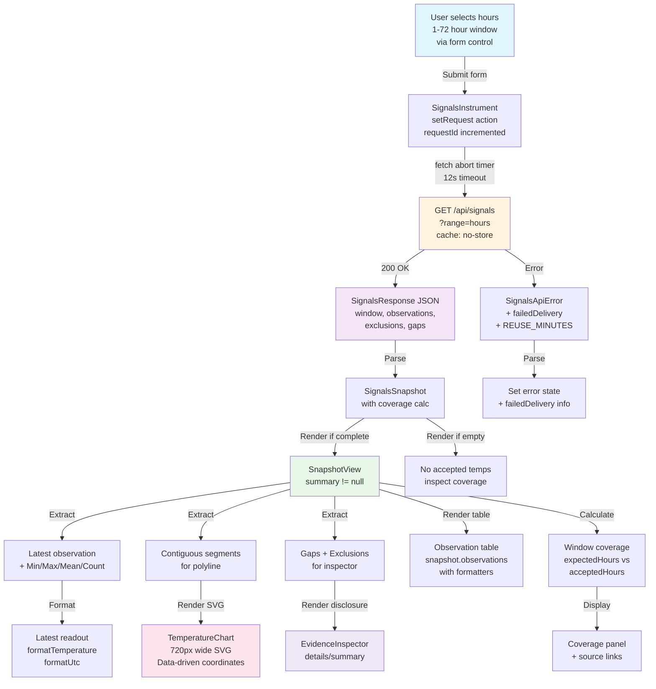
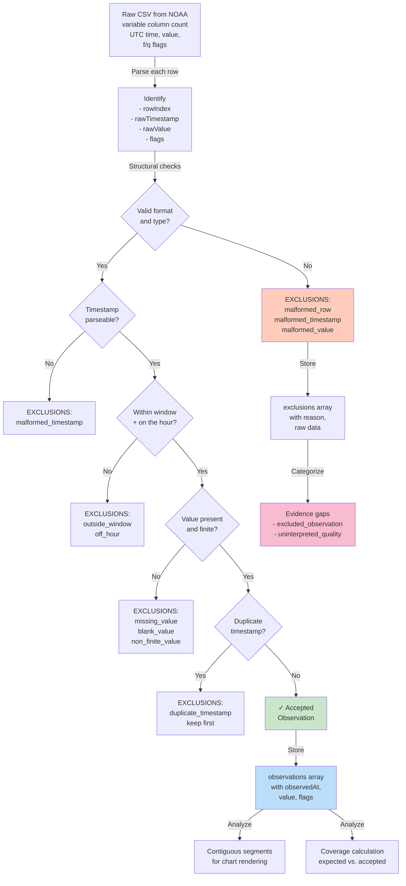
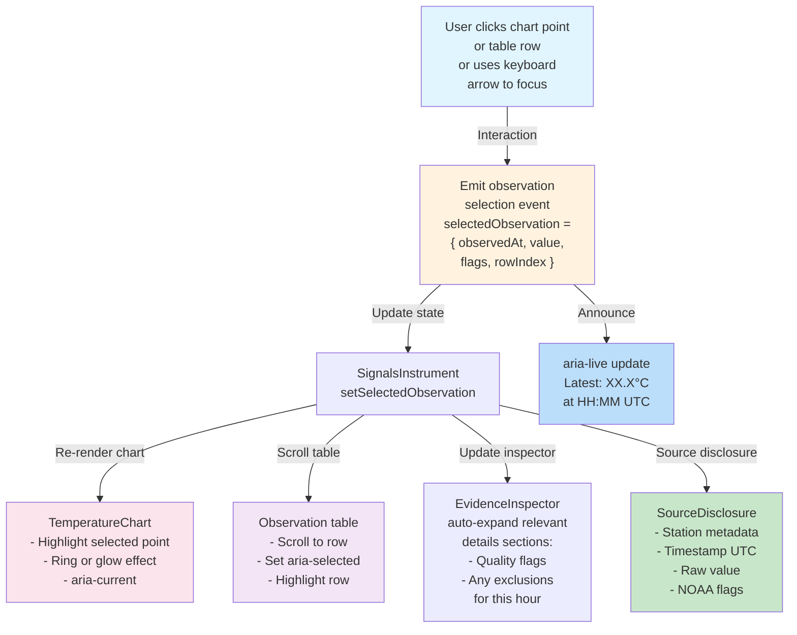
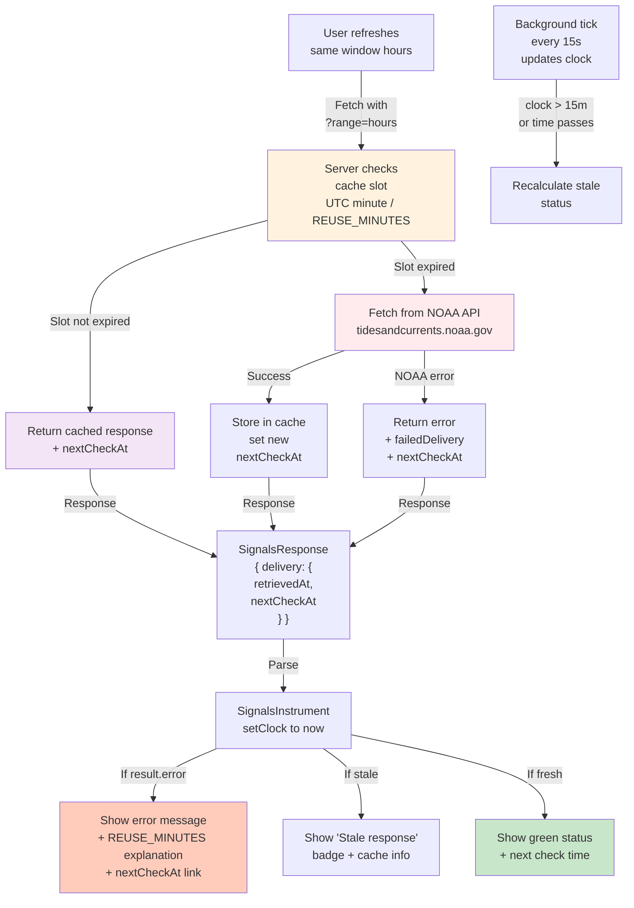
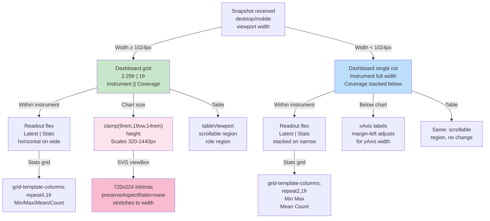

# STRATA-016: Data Lineage and Validation Pipeline

**Purpose:** Trace actual NOAA observations through the signals request, validation, coverage analysis, and visualization paths. Distinguish implemented behavior from proposed enhancements.

---

## End-to-End Data Flow

**Key transitions:**
- **Request initiation:** `setRequest()` increments `requestId`, triggering `useEffect` fetch
- **Response caching:** `cache: 'no-store'` prevents browser cache; server respects `REUSE_MINUTES` UTC slot bucketing
- **Error handling:** Preserves `failedDelivery.nextCheckAt` to show when cache slot expires
- **Snapshot branching:** `summary` existence determines empty vs. complete render
- **Formatting boundary:** Data model (UTC, raw values, quality flags) → Display (localized time, rounded temps, label text)

---

## Observation Validation and Exclusion Pipeline

**Implemented validation steps** (in `observations.ts` and server adapter):
- Row-by-row structural validation
- Timestamp parsing and window/hour checking
- Value type and range (non-finite) validation
- Duplicate timestamp de-duplication (first wins)
- Quality flag preservation (not interpreted, only flagged for review)

**Coverage semantics:**
- `expectedHours`: Span of window in complete UTC hours
- `acceptedHours`: Count of observations with valid values
- `missingHours`: Expected hours with no accepted row (None, some, or all)
- `gaps`: Detailed evidence for each missing hour (why the gap, what to check next)

---

## Proposed Observation Selection and Inspector Update Flow

**Proposed behavior** (not yet implemented):
- Selection initiates coordinated highlight across chart, table, and inspector
- Chart point gets visual ring or glow; aria-current="true" on SVG element
- Table row scrolls into view; aria-selected="true" set
- Inspector auto-expands details relevant to selected observation
- Source metadata always displayed for selected observation
- Announcement updates reading order for screen readers
- Keyboard navigation: Arrow keys move focus through observations; Enter/Space selects

**Current gap:** No coordinated selection state; chart and table are read-only.

---

## Cache Policy and Freshness Model

**Current implementation** (in `delivery.ts` and server):
- REUSE_MINUTES bucketing: Requests in same UTC minute slot reuse cached response
- `nextCheckAt`: ISO string when cache slot expires and new data is available
- 15s background clock tick updates stale badge visibility
- Never displays hardcoded/simulated values; always preserves `retrievedAt` and `nextCheckAt`
- Error state includes `failedDelivery` with next check time (even on failure)

**Transparency contract:**
- User always knows when data was retrieved
- User always knows when to check back for fresh data
- No spinning loader without timeout or clear "checking cache" message
- Manual refresh button respects cache slot (truthful, not forced fresh)

---

## Responsive Rendering and Layout Transitions

**Current responsive behavior:**
- **Desktop (≥1024px):** Two-column dashboard with proportional grid
- **Tablet (768–1023px):** Implicit single column via minmax; dashboard collapses gracefully
- **Mobile (<768px):** Full single column; all sections stack
- **Chart:** Maintains aspect via viewBox + height clamp; SVG text/axis scale naturally
- **Table:** Scrollable viewport on all sizes; no forced horizontal scroll of page

**Proposed enhancement:** Explicit media queries at 375px, 768px, 1024px breakpoints for state-specific inspector placement (mobile: bottom sheet; tablet: inline; desktop: persistent right sidebar).

---

## Summary: Implementation Readiness

| Component | Implemented | Proposed | Handoff Note |
| --- | --- | --- | --- |
| **Request/Response** | ✓ Full pipeline with cache | ✓ Add loading spinner | No scientific data changes |
| **Validation** | ✓ Comprehensive exclusion logic | ✓ Categorize more explicitly | Preserve all flags |
| **Chart Rendering** | ✓ SVG with gaps | ✓ Add selection highlight | No new dependencies |
| **Table** | ✓ Semantic with all data | ✓ Row selection state | Use aria-selected |
| **Inspector** | ✓ Evidence gaps displayed | ✓ Coordinate with selection | Auto-expand relevant sections |
| **Cache Transparency** | ✓ nextCheckAt shown | ✓ Visual countdown | Never fabricate data |
| **Responsive** | ✓ Foundation solid | ✓ Explicit breakpoints | Test at 320/375/768/1024/1440 |

---

**Diagram set complete. Ready for Concept A and B interaction specifications.**
