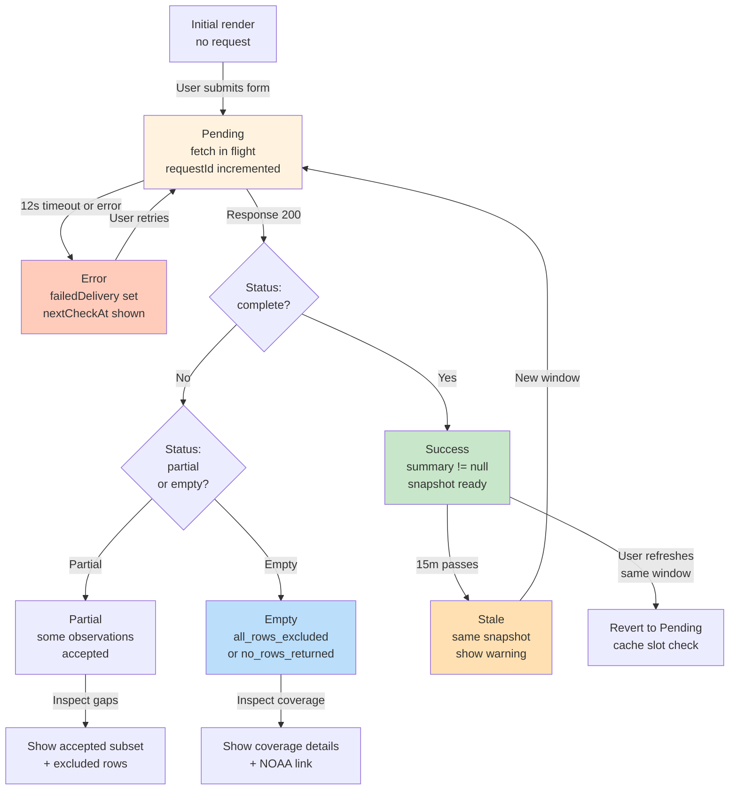

# STRATA-016: Interaction State Model and Visual Treatment

**Purpose:** Define the instrument's current and proposed visual treatment for loading, success, partial, stale, empty, and failure states. Ground each state in actual code paths.

---

## State Machine Overview



**State transitions** (from `signalsStatus()` in `delivery.ts`):
1. **Initial:** No data loaded; show form control only
2. **Pending:** `result.requestId !== request.id`; show placeholder or prior data dimmed
3. **Success:** `status === 'complete'` and `!stale`; full render
4. **Partial:** `status === 'partial'`; render accepted subset; note gaps
5. **Empty:** `status === 'empty'`; explain emptyReason
6. **Stale:** `status === 'complete'` and `stale === true`; show badge, preserve data
7. **Error:** `result.error !== null`; show error message and failedDelivery.nextCheckAt

---

## Detailed State Visual Treatment

### Initial State (No Request)

```
╔════════════════════════════════════════╗
║ HEADER                                 ║
╠════════════════════════════════════════╣
│ Observation window: [1 hour ▾]         │
│ [Refresh data]  Next cache slot: —     │
╚════════════════════════════════════════╝

[Empty dashboard — optional placeholder]
```

**UI elements:**
- Form control visible and enabled
- Status line empty or shows default message
- No instrument panel rendered

**Current code:** `!result && !lastSnapshot` → no SnapshotView rendered

---

### Pending State (Fetch in Flight)

```
╔════════════════════════════════════════╗
║ HEADER                                 ║
╠════════════════════════════════════════╣
│ Observation window: [24 hours ▾] ⟳    │
│ [Applying window...]  Fetching...      │
╚════════════════════════════════════════╝

┌─────────────────────────────────────┐
│ ⟳ Checking cache... (usually <1s)  │
│                                     │
│ This may take up to 12 seconds if   │
│ a fresh NOAA request is needed.     │
└─────────────────────────────────────┘
```

**Visual treatment:**
- Spinner/loading indicator in status line
- Form control disabled (prevent double-submit)
- Status text changes to "Checking cache..." or "Fetching fresh data..."
- Keep previous successful snapshot visible but slightly dimmed (optional)
- No timeout message yet (timeout is 12s, stay patient)

**Current code:**
```typescript
const pending = result?.requestId !== request.id;
// No explicit pending UI; falls through to empty state or prior snapshot
```

**Proposed enhancement:** Add explicit pending state render with brief loader and clear message.

---

### Success State (Complete, Fresh)

```
╔════════════════════════════════════════╗
║ HEADER                                 ║
╠════════════════════════════════════════╣
│ Observation window: [24 hours ▾]       │
│ [Refresh data]  Complete ✓ 2 min ago  │
╚════════════════════════════════════════╝

┌─────────────────────────────────┐  ┌──────────────┐
│ Water temperature               │  │ Coverage     │
│ NOAA hourly observations · °C   │  │ ━━━━━━━━━━━ │
│                                 │  │ 23/24 hours  │
│ Latest: 15.3 °C                 │  │ accepted     │
│          06 Nov 15:00 UTC       │  │              │
│                                 │  │ Details →    │
│ ┌──────────────────────────────┐│  │              │
│ │ Chart with colored line,    ││  │              │
│ │ grid, points, and gaps      ││  │              │
│ │ [Interactive points]        ││  │              │
│ └──────────────────────────────┘│  │              │
│                                 │  │              │
│ Min: 12.1 °C                    │  │              │
│ Max: 18.2 °C  Mean: 15.4 °C     │  │              │
│ Accepted: 23                    │  │              │
│                                 │  └──────────────┘
└─────────────────────────────────┘

[Evidence Gaps section]
[Observation Table]
[Method and Limitations]
```

**Visual treatment:**
- Status line shows ✓ and "Complete" in calm color
- Relative time: "2 min ago", "just now", "1 hour ago"
- Dashboard two-column grid visible (desktop)
- All sections rendered with full data
- Chart points are interactive (hover shows value, click selects)
- Table rows can be clicked to select/inspect

**Current code:**
```typescript
if (snapshot && status.stale === false) {
  // SnapshotView rendered with all sections
  status.text = "Complete · 2 min ago" (via signalsStatus)
}
```

---

### Partial State (Some Data Accepted)

```
╔════════════════════════════════════════╗
║ HEADER                                 ║
╠════════════════════════════════════════╣
│ Observation window: [24 hours ▾]       │
│ [Refresh data]  Partial — 8/24 hours   │
╚════════════════════════════════════════╝

[Same layout as Success, but:]

Coverage panel shows:
⚠ 8/24 hours accepted
Received 24 rows
Excluded: 8 rows

Evidence gaps section expanded to show:
- 16 expected hours without an accepted value
- 8 excluded raw rows (reasons listed)
- Quality field review: 1 accepted with flags
```

**Visual treatment:**
- Status line in amber/warning color: "Partial — 8/24 hours"
- Coverage panel highlights low acceptance rate
- Evidence gaps section more prominent (expanded or highlighted)
- Chart shows gaps clearly (hatched pattern)
- Table renders only the 8 accepted rows
- Inspector sections explain why data was excluded

**Current code:**
```typescript
if (snapshot?.status === 'partial') {
  status.text = "Partial · " + snapshot.coverage.acceptedHours + "/" + ...
  status.stale = false
}
```

---

### Empty State (No Observations Accepted)

```
╔════════════════════════════════════════╗
║ HEADER                                 ║
╠════════════════════════════════════════╣
│ Observation window: [24 hours ▾]       │
│ [Refresh data]  Empty — no data        │
╚════════════════════════════════════════╝

┌─────────────────────────────────────┐
│ No accepted temperatures are        │
│ available for this response.        │
│ Inspect coverage and raw-row        │
│ findings below.                     │
└─────────────────────────────────────┘

[Coverage panel]
Full details of why all rows excluded

[Evidence gaps section]
Categorized list of reasons

[Observation table]
Empty: "There are no accepted rows..."

[Method section]
```

**Visual treatment:**
- Status line in info/cyan color: "Empty — no data"
- No readout (no latest, no stats)
- No chart rendered
- Instrument panel shows clear message, not blank
- Coverage panel full detail on why window is empty
- Evidence inspector fully expanded to explain
- Table shows "No rows" message

**Current code:**
```typescript
if (snapshot && !summary) {
  // summary is null; show empty state
  <p className={styles.empty}>No accepted temperatures...</p>
}
```

---

### Stale State (Data Present but Old)

```
╔════════════════════════════════════════╗
║ HEADER                                 ║
╠════════════════════════════════════════╣
│ Observation window: [24 hours ▾]       │
│ [Refresh data]  Stale — 18 min ago     │
╚════════════════════════════════════════╝

┌─────────────────────────────────────┐  ┌──────────────┐
│ Water temperature                   │  │ Coverage     │
│ NOAA hourly observations · °C       │  │ ━━━━━━━━━━ │
│                                     │  │ 23/24 hours  │
│ Latest: 15.3 °C          [STALE]    │  │              │
│          06 Nov 15:00 UTC            │  │              │
│                                     │  │              │
│ [Faded chart]                       │  │              │
│                                     │  │              │
│ [Stats dimmed]                      │  │              │
│                                     │  │              │
│ Cache slot starts refreshing at:    │  │              │
│ 06 Nov 15:28 UTC                    │  │              │
│                                     │  └──────────────┘
└─────────────────────────────────────┘

[Sections visible but slightly faded]
```

**Visual treatment:**
- Status line in amber: "Stale — 18 min ago"
- "STALE" badge appears in instrument header
- Data still displayed but visually de-emphasized (opacity 0.75–0.85)
- Status line shows when cache will refresh: "Next cache slot: HH:MM UTC"
- User can still inspect data while waiting for fresh fetch
- Refresh button behaves normally (respects cache slot)

**Current code:**
```typescript
if (status.stale) {
  <span className={styles.stale}>Stale response</span>
  // Data still rendered, but className applies faded style
}
```

---

### Error State (Fetch Failed)

```
╔════════════════════════════════════════╗
║ HEADER                                 ║
╠════════════════════════════════════════╣
│ Observation window: [24 hours ▾]       │
│ [Refresh data]  Error — Unable to get  │
╚════════════════════════════════════════╝

┌─────────────────────────────────────┐
│ ✕ Could not load the observation    │
│   window                            │
│                                     │
│ Refresh checks the shared cache.    │
│ NOAA connection issues or UTC slot  │
│ expiration may have caused this     │
│ failure.                            │
│                                     │
│ Next cache check at:                │
│ 06 Nov 15:28 UTC (in 12 minutes)    │
│                                     │
│ [Check the NOAA station page] →     │
└─────────────────────────────────────┘

[Previous successful snapshot preserved below]
(optional, for context)
```

**Visual treatment:**
- Status line in error/red color: "Error — Unable to load"
- Error panel rendered instead of dashboard
- Clear error message
- Next cache slot time shown so user knows when to retry
- Link to NOAA station page for manual check
- Previous successful data may remain visible below (for context) but faded

**Current code:**
```typescript
if (error && !snapshot) {
  <section className={styles.panel} aria-labelledby="signals-error">
    <h2 id="signals-error">Could not load the observation window</h2>
    <a href={STATION.url}>Check the NOAA station page</a>
  </section>
}
```

**Current gap:** No "next check time" message in error state; `failedDelivery.nextCheckAt` exists but is not shown.

---

## Accessibility Treatment Across States

| State | ARIA Live | Focus Management | Keyboard | Screen Reader |
| --- | --- | --- | --- | --- |
| **Pending** | `aria-live="polite"` | Focus remains on submit button | Form disabled (prevent re-submit) | "Checking cache..." announcement |
| **Success** | `role="status"` aria-atomic | Focus to dashboard heading | Tab through chart/table/inspector | Full heading/section structure |
| **Partial** | `role="status"` aria-atomic | Focus to coverage section | Tab order: form → chart → table → gaps | Announce "Partial" in status |
| **Empty** | `role="status"` aria-atomic | Focus to coverage section | Tab order: form → coverage → gaps | "No accepted temperatures" |
| **Stale** | `role="status"` aria-atomic | Focus to refresh button | Tab normally, stale badge in flow | "Stale response, 18 minutes ago" |
| **Error** | `role="status"` aria-atomic, role="alert" | Focus to error heading | Keyboard to NOAA link | Error message, next check time |

**Keyboard navigation pattern:**
1. Tab to form control
2. Tab to Refresh button
3. Tab to chart (or first interactive point if selection implemented)
4. Tab through table rows
5. Tab to evidence inspector details
6. Tab to method section

---

## Proposed Loading Skeleton States

For better perceived performance, consider brief placeholder renders while pending:

```
Pending → Skeleton (100ms)
  ┌──────────────────┐  ┌────────┐
  │ ░░░░░░░░░░░░░░  │  │ ░░░░░░ │
  │ ░░░░░░░░░░░░░░  │  │ ░░░░░░ │
  │ ░░░░░░░░░░░░░░  │  │ ░░░░░░ │
  │ [Chart skeleton]  │  │ [Stats]│
  │ ░░░░░░░░░░░░░░  │  │        │
  │ ░░░░░░░░░░░░░░  │  │        │
  └──────────────────┘  └────────┘

After 500ms, show brief status:
"Checking cache... (usually < 1s)"

After 5s, show:
"Fetching fresh NOAA data... (up to 10s more)"
```

**Current behavior:** No explicit pending UI; falls back to previous snapshot or empty state. Consider adding this for better UX on slow connections.

---

## Summary: State Coverage Checklist

| State | Rendering | Status Text | Accessibility | Interactive | Coverage |
| --- | --- | --- | --- | --- | --- |
| Initial | ✓ Form only | — | ✓ | Form enabled | 100% |
| Pending | ⏳ Implicit | ⏳ Minimal | ✓ | Form disabled | Need spinner |
| Success | ✓ Full | ✓ Complete + time | ✓ | Full | 100% |
| Partial | ✓ Full | ✓ Partial + count | ✓ | Full | 100% |
| Empty | ✓ Explanation | ✓ Empty + reason | ✓ | Coverage/links | 100% |
| Stale | ✓ Full/faded | ✓ Stale + time | ✓ | Full | 100% |
| Error | ✓ Message | ✓ Error + action | ✓ | NOAA link | 100% |

**Next step:** Implement pending skeleton and error nextCheckAt visibility in Stage B.

---

**State model complete. Ready for Concept A and B state-specific mockups.**
