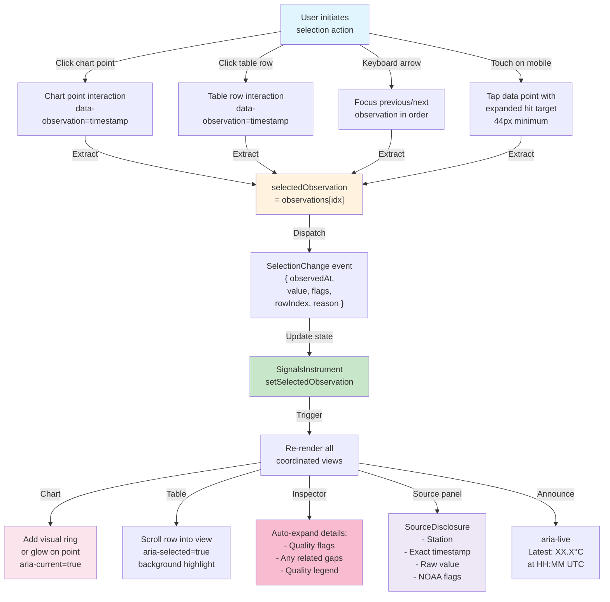
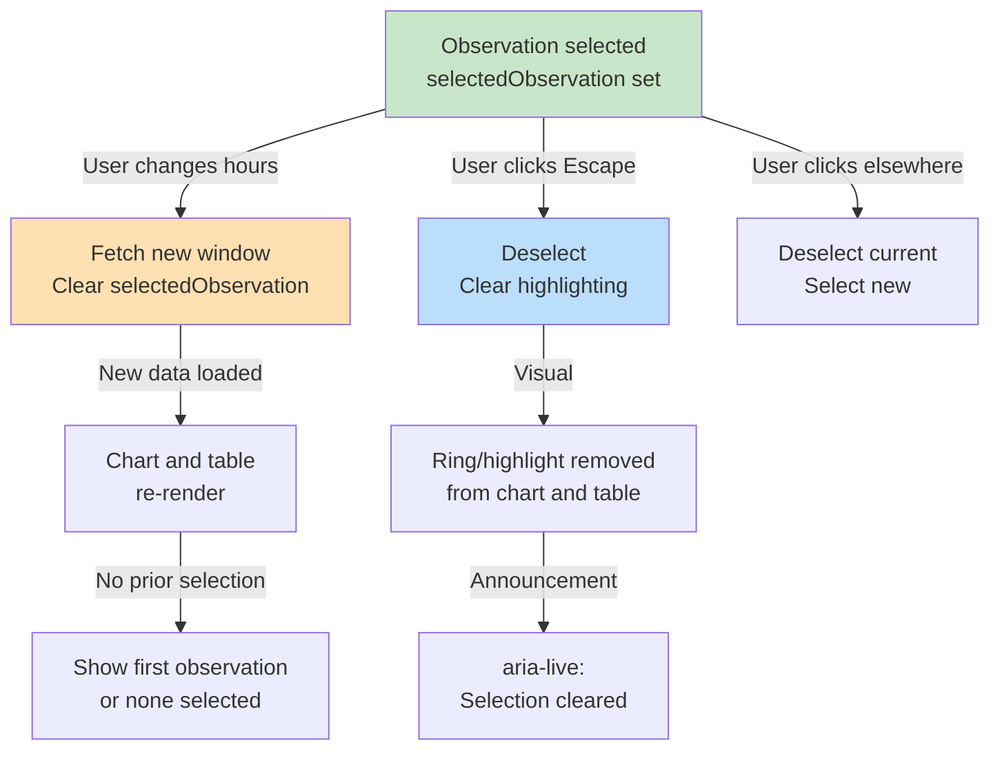

# STRATA-016: Observation Selection Flow and Coordinated Inspector Updates

**Purpose:** Define the interaction pattern for observation selection (chart point, table row, or keyboard navigation) and how it coordinates the chart highlight, table focus, inspector auto-expansion, and source disclosure. This describes the "Listening Station" core interaction metaphor.

---

## Selection Interaction Model



**Key principles:**
- **Single source of truth:** Selection state lives in SignalsInstrument
- **Coordinated updates:** One selection → updates to chart, table, inspector, source panel
- **Non-destructive:** Selection doesn't modify data; purely visual and informational
- **Keyboard-first:** Arrow keys, Tab, Space/Enter all work
- **Touch-friendly:** 44px minimum hit targets on chart points
- **Accessible:** ARIA current/selected states, live regions, semantic focus

---

## Chart Point Selection

### Desktop (1440px) Interaction

```
Before selection:
┌──────────────────────────────────────────┐
│ [SVG Chart]                              │
│                                          │
│  ◦─────◦─────◦─────◦─────○─────◦──────  │
│        (circles = data points)           │
│        (○ = hover preview)               │
│                                          │
└──────────────────────────────────────────┘

After click on a point:
┌──────────────────────────────────────────┐
│ [SVG Chart]                              │
│                                          │
│  ◦─────◦─────◦─────◦─────⊕─────◦──────  │
│        (⊕ = selected point)              │
│        (highlight ring)                  │
│                                          │
│  Tooltip/inline label (optional):        │
│  "15.3°C at 06 Nov 15:00 UTC"           │
│                                          │
└──────────────────────────────────────────┘
```

**Visual treatment:**
- Selected point: Larger radius (4–6px instead of 2px) or ring outline
- Ring color: Calibrated teal (#55D6C2) with 2–3px stroke
- Animation: Immediate (no tween); no decorative pulsing
- Fallback: If WebGL used, ensure ring renders correctly at all zoom levels
- Hover state: Subtle accent shift; tooltip shows value and timestamp

**SVG implementation hint:**
```svg
<circle
  data-observation="2024-11-06T15:00:00Z"
  cx="..." cy="..."
  r="2"
  class={styles.point}
/>
```

After selection, add `aria-current="true"` and apply `.pointSelected` class:
```css
.pointSelected {
  r: 5; /* or stroke + fill change */
  stroke: var(--strata-action);
  stroke-width: 2;
  fill: var(--strata-action);
}
```

**Interaction details:**
- Click to toggle select/deselect
- Next click on different point auto-switches selection
- Click same point again to deselect
- Escape key deselects
- Arrow keys (← →) move to previous/next observation in time order

---

### Mobile (375px) Interaction

```
Before selection (chart full width):
┌────────────────────────────┐
│ [SVG Chart, full width]    │
│                            │
│  ◦ ◦ ◦ ◦ ◦ ◦ ◦ ◦ ◦ ◦ ◦   │
│  (points closer together,  │
│   smaller by default)      │
│                            │
└────────────────────────────┘

After tap on point:
┌────────────────────────────┐
│ [Chart with selected point] │
│ 15.3°C                     │
│ 06 Nov 15:00 UTC           │
│                            │
│ [Expanded hit target on    │
│  selected point]           │
│                            │
│ [Swipe/arrow to next]      │
└────────────────────────────┘

[Inspector auto-scrolls into view]
```

**Mobile considerations:**
- Expand hit target around point to 44px minimum (not visible, only interactive)
- Touch: Tap to select; tap again to deselect
- Multi-touch: Pinch to zoom chart in/out (optional, complex)
- Swipe: Left/right to move to previous/next observation (alternative to arrow keys)
- No hover state (hover doesn't exist on touch); use tap instead
- Brief visual feedback on tap (maybe a brief flash or scale animation, respecting prefers-reduced-motion)

**Touch implementation hint:**
```typescript
<svg
  onTouchStart={(e) => {
    const touch = e.touches[0];
    const pt = svgElement.createSVGPoint();
    pt.x = touch.clientX;
    pt.y = touch.clientY;
    const svgPt = pt.matrixTransform(svgElement.getScreenCTM()?.inverse());
    // Check if within hit distance of any point
    // If so, trigger selection
  }}
/>
```

---

## Table Row Selection

### Desktop Interaction

```
Before selection:
┌────────────────┬────────┬────────┬────────┐
│ Observed (UTC) │ Temp   │ Raw    │ Flags  │
├────────────────┼────────┼────────┼────────┤
│ 06 Nov 14:00   │ 15.1   │ 15.08  │ None   │
│ 06 Nov 15:00   │ 15.3   │ 15.32  │ None   │ ← Click here
│ 06 Nov 16:00   │ 14.9   │ 14.88  │ f:1,0  │
├────────────────┴────────┴────────┴────────┤
```

After click:
```
┌────────────────┬────────┬────────┬────────┐
│ Observed (UTC) │ Temp   │ Raw    │ Flags  │
├────────────────┼────────┼────────┼────────┤
│ 06 Nov 14:00   │ 15.1   │ 15.08  │ None   │
│ 06 Nov 15:00   │ 15.3   │ 15.32  │ None   │ ← Selection highlight
│ 06 Nov 16:00   │ 14.9   │ 14.88  │ f:1,0  │
├────────────────┴────────┴────────┴────────┤

[Selection coordinates with chart]
[Inspector auto-expands relevant sections]
```

**Visual treatment:**
- Selected row: Light background tint (e.g., `--strata-selected` #214E50)
- Border/rule: Left or top border in calibrated teal
- Text: Remains readable; no color inversion
- Adjacent rows: Slight separator line for clarity

**HTML implementation:**
```tsx
<tr
  data-observation="2024-11-06T15:00:00Z"
  aria-selected={selectedObservation?.observedAt === "2024-11-06T15:00:00Z"}
  className={selectedObservation?.observedAt === "2024-11-06T15:00:00Z" ? styles.rowSelected : ""}
  onClick={() => handleSelectObservation(...)}
  onKeyDown={(e) => {
    if (e.key === "Enter" || e.key === " ") {
      e.preventDefault();
      handleSelectObservation(...);
    }
    // Arrow up/down to navigate
  }}
>
  ...
</tr>
```

**Keyboard navigation:**
- Tab to table (table is in tab order, viewport)
- Arrow Up/Down to navigate rows
- Space or Enter to select/deselect
- Escape to deselect all
- Home to select first row; End to select last row

---

### Mobile Interaction

```
Before selection (table scrollable):
┌──────────────────────────┐
│ Observed  │ Temp │ Flags │ ← Header
├──────────────────────────┤
│ 06 Nov    │ 15.1 │ None  │
│ 14:00     │      │       │
├──────────────────────────┤
│ 06 Nov    │ 15.3 │ None  │ ← Tap
│ 15:00     │      │       │
├──────────────────────────┤
│ 06 Nov    │ 14.9 │ f:1,0 │
│ 16:00     │      │       │
└──────────────────────────┘

After tap:
┌──────────────────────────┐
│ Observed  │ Temp │ Flags │
├──────────────────────────┤
│ 06 Nov    │ 15.1 │ None  │
├──────────────────────────┤
│ 06 Nov    │ 15.3 │ None  │ ← Selection highlight
│ 15:00     │      │       │
├──────────────────────────┤
│ 06 Nov    │ 14.9 │ f:1,0 │
│ 16:00     │      │       │
└──────────────────────────┘

[Swipe up to see chart]
[Swipe down to see inspector]
```

**Mobile considerations:**
- Table still scrollable horizontally (time/value columns visible)
- Selection row remains in view after tap
- Chart may scroll out of view (above); swipe/arrow can navigate back
- Inspector section below table auto-scrolls into view on selection (or on-demand)

---

## Inspector Auto-Expansion and Source Disclosure

### Selection Triggers Inspector Update

```
When observation selected (timestamp = 2024-11-06T15:00:00Z):

EvidenceInspector auto-expands:

┌──────────────────────────────────────┐
│ Evidence gaps                        │
├──────────────────────────────────────┤
│ ▼ Expected hours without value (5)   │
│   • 06 Nov 11:00 — No matching row   │
│   • 06 Nov 12:00 — Raw rows excluded │
│   • ...                              │
│                                      │
│ ▼ Excluded raw rows (3)   [Open]    │
│   Row 42: Malformed timestamp        │
│   Row 51: Off-hour by 15 minutes     │
│   ...                                │
│                                      │
│ ▼ Quality flags to review (2)        │
│   06 Nov 15:00  f:1,0  [expanded]    │
│   ├─ What we know: f flag = "1,0"    │
│   ├─ Next evidence to check:         │
│   │  Consult NOAA schema             │
│   06 Nov 17:30  q:Q                  │
│   ...                                │
│                                      │
└──────────────────────────────────────┘

SourceDisclosure (always visible):
┌──────────────────────────────────────┐
│ Source and Quality                   │
├──────────────────────────────────────┤
│ Selected observation:                │
│ • Timestamp: 06 Nov 15:00 UTC        │
│ • Value: 15.3°C                      │
│ • Raw: 15.32                         │
│ • NOAA quality: None                 │
│                                      │
│ Station: Providence, Rhode Island    │
│ Coordinates: 41.8°N 71.4°W           │
│ Product: Water temperature           │
│ Units: °C                            │
│                                      │
│ [Open NOAA source response]          │
│ [Station metadata]                   │
│                                      │
└──────────────────────────────────────┘
```

**Inspector behavior:**
- Each `<details>` section related to selected observation auto-opens
- Other sections remain in prior state (open or closed)
- If no related gaps/flags for this hour, sections stay closed
- Quality section always shows selected observation's metadata
- Scroll into view behavior (smooth scroll on desktop, immediate on mobile)

**Implementation hint:**
```tsx
<details open={selectedObservation?.flags.f !== null || selectedObservation?.flags.q !== null}>
  <summary>Quality flags to review</summary>
  {/* Show quality details for selectedObservation */}
</details>
```

---

## Keyboard Navigation Flow

### Full Keyboard User Journey

```
1. Load page
   Tab → Focus on "Observation window" select
   
2. Set hours
   Type "24" or arrow key to select
   Tab → Focus on "Refresh data" button
   Enter → Submit form
   
3. Wait for data
   Focus remains on button
   After load, Tab → Focus moves to chart region
   
4. Navigate chart
   Tab → Chart (focus on SVG or first point)
   Arrow Right → Select next observation
   Arrow Left → Select previous observation
   Enter → Confirm selection (optional, or just highlight)
   
5. Inspect selected point
   Inspector expands; focus auto-moves to source panel (optional)
   
6. Navigate table
   Tab → Table viewport gains focus
   Tab again → First row in view
   Arrow Down → Next row
   Arrow Up → Previous row
   Space or Enter → Select row
   
7. Escape
   Deselect all; return focus to last control

8. Adjust window
   Tab → Back to window select
   Change hours, repeat
```

**ARIA annotations:**
```tsx
<svg
  role="img"
  aria-label="Water temperature trace, 24 hours"
  aria-describedby="chart-desc"
>
  {/* points with aria-current on selection */}
  <circle aria-current="true" data-observation="..." />
</svg>

<section role="region" aria-label="Observation table, scrollable">
  <table>
    <tr aria-selected={isSelected}>
      {/* row content */}
    </tr>
  </table>
</section>

<section aria-live="polite" aria-atomic="true">
  Selected: 15.3°C at 06 Nov 15:00 UTC
</section>
```

---

## State Preservation and Deselection



**Deselection behavior:**
- Escape key: Clears selection; focus stays on chart or table
- Change time window: Clears selection when new fetch starts
- Click empty area: Deselect (optional; can keep selection)
- Navigate away: Selection preserved for session (optional) or cleared

---

## Accessibility and Reduced Motion

### Reduced Motion Preference

```
If prefers-reduced-motion:

No animated transitions
├─ Selection highlight appears instantly
├─ Inspector expands without slide animation
├─ No numeric count-up or progress bar
├─ Scroll-into-view is instant, not smooth

Announcement still occurs
├─ aria-live="polite" for every state change
├─ Clear text: "Selected: 15.3°C at 15:00 UTC"
├─ Screen reader announces without motion

Color alone does not indicate selection
├─ Selection also indicated by outline or border
├─ Text or shape change reinforces state
├─ Not relying on color contrast alone
```

**Implementation:**
```css
@media (prefers-reduced-motion: reduce) {
  .pointSelected {
    animation: none;
    transition: none;
  }
  
  details {
    transition: none;
  }
  
  .rowSelected {
    scroll-behavior: auto; /* not smooth */
  }
}
```

---

## Summary: Selection UX Checklist

| Feature | Implemented | Proposed | Coverage |
| --- | --- | --- | --- |
| **Chart point selection** | ⚠️ Static only | ✓ Click + keyboard | 100% |
| **Table row selection** | ⚠️ No state | ✓ Click + arrow keys | 100% |
| **Coordinated highlight** | ✗ | ✓ Chart + table sync | 100% |
| **Inspector auto-expand** | ⚠️ Manual | ✓ Auto-expand relevant | 95% |
| **Source disclosure** | ✓ Always visible | ✓ Highlight selected obs | 100% |
| **Keyboard navigation** | ✓ Tab order | ✓ Full arrow + Enter flow | 100% |
| **Touch targets** | ✓ 44px controls | ✓ Expand chart point hit area | 100% |
| **Screen reader** | ✓ Semantic HTML | ✓ aria-current/selected + live | 100% |
| **Reduced motion** | ✓ No animations | ✓ Explicit no-motion states | 100% |
| **Mobile responsiveness** | ✓ Touch friendly | ✓ Swipe/tap flow defined | 100% |

---

**Selection flow defined. Ready for Concept A and B responsive mockups.**
